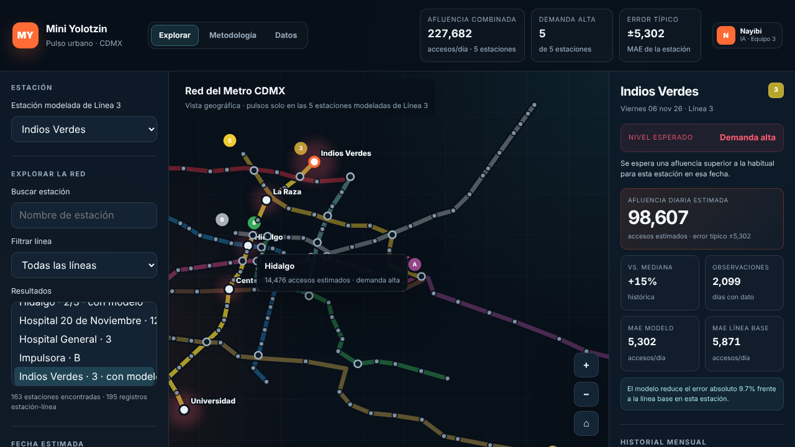

# Mini Yolotzin

Aplicación web académica para explorar estimaciones de afluencia diaria en las 163 estaciones (195 registros estación-línea) del Metro de la Ciudad de México.


## Sitio público

Después de activar GitHub Pages, la aplicación estará disponible en:

<https://nayibi21.github.io/mini-yolotzin/>

## Qué incluye

- Vista **Explorar** a pantalla completa en tres columnas: controles de estación y fecha, mapa esquemático y detalle de la estación.
- Predicción diaria para cada estación y línea de la red (un modelo por registro, como lo publica el recurso oficial), con su error típico (MAE) y aviso de confiabilidad baja cuando el error supera el 30% de la afluencia habitual.
- Etiqueta de días festivos, fechas especiales y vacaciones en la fecha elegida.
- En las estaciones de correspondencia se puede elegir la línea. Indios Verdes, La Raza, Hidalgo, Centro Médico y Universidad (Línea 3) siguen como estaciones destacadas.
- Comparación del modelo Random Forest contra una línea base histórica.
- Mapa geográfico de la red completa (catálogo oficial SEMOVI/STC: 163 estaciones, 195 registros estación-línea) con reproducción por fecha (1, 3 o 7 días), zoom, arrastre y selección con ratón o teclado.
- Búsqueda de estaciones (sin importar acentos), filtro por línea y ficha geográfica para las estaciones que no tienen modelo.
- Historial mensual en barras y lista de estaciones ordenadas por demanda relativa.
- Pestañas **Metodología** y **Datos** con el proceso, la cobertura y la validación por estación.
- Perfiles locales de clase que se guardan solamente en el navegador.
- Información de metodología, cobertura, errores y limitaciones.

Las estimaciones no representan ocupación dentro de los trenes, saturación de andenes ni datos en tiempo real.

| Mapa y detalle | Perfil local |
|---|---|
|  |  |

## Abrirla en una computadora

No requiere instalación para visualizarla:

1. Descarga o clona el repositorio.
2. Conserva juntos `index.html`, `model-data.js`, `metro-catalog.js` y `weather-summary.js`.
3. Abre `index.html` con Chrome, Safari, Firefox o Edge.

## Editar con ChatGPT, Codex o Claude

Abre la carpeta completa del repositorio en la herramienta que utilices y describe el cambio deseado. Antes de aceptar un cambio, pide que:

1. Lea `AGENTS.md`.
2. Conserve las limitaciones metodológicas.
3. No agregue contraseñas, tokens o claves dentro del código.
4. Compruebe que `index.html` carga `model-data.js` sin errores.
5. Resuma los archivos modificados.

Ejemplo de solicitud:

> Lee README.md y AGENTS.md. Cambia el texto de la pantalla de bienvenida sin modificar el modelo ni las predicciones. Revisa que la página siga funcionando en celular y dime qué archivos cambiaste.

## Trabajo entre colaboradoras

Antes de comenzar un cambio:

1. Sincronicen o descarguen la versión más reciente.
2. Procuren que una sola persona modifique `index.html` a la vez.
3. Guarden cada tarea en un commit pequeño con un mensaje descriptivo.
4. Suban el cambio y comprueben la página publicada.

Para cambios grandes, creen una rama y una Pull Request antes de mezclarla con `main`. Consulta [CONTRIBUTING.md](CONTRIBUTING.md).

## Publicar con GitHub Pages

En el repositorio, ve a:

`Settings → Pages → Build and deployment → Deploy from a branch`

Selecciona la rama `main`, la carpeta `/(root)` y pulsa **Save**. Los cambios enviados a `main` volverán a publicar la página automáticamente.

## Regenerar las estimaciones

Esto solo es necesario cuando se quiera actualizar el archivo oficial o volver a entrenar el modelo.

1. Descarga el CSV oficial de afluencia y guárdalo en la raíz con el nombre `afluencia_simple.csv`. SEMOVI lo actualiza una vez al mes; basta con repetir este proceso cuando se quiera incorporar un mes nuevo. El portal puede rechazar conexiones desde servidores en la nube: descárgalo desde un navegador.
2. Crea un entorno de Python e instala las dependencias:

```bash
python3 -m venv .venv
source .venv/bin/activate
pip install -r requirements.txt
```

3. Ejecuta:

```bash
python scripts/build_model_data.py
```

El script reemplaza `model-data.js` (también acepta rutas: `python scripts/build_model_data.py ruta/al.csv salida.js`). Tarda alrededor de dos minutos. Reglas que aplica:

- Un modelo Random Forest por estación y línea; validación con los últimos 180 días observados.
- Variables de calendario: mes, día de la semana, día del mes, fin de semana, ciclo anual, **días festivos oficiales** (Ley Federal del Trabajo, art. 74), **fechas especiales** (Jueves y Viernes Santo, Día de Muertos, 12 de diciembre, 24 y 31 de diciembre), **puentes** y **vacaciones** aproximadas (Semana Santa y del 18 de diciembre al 6 de enero).
- Se entrena desde el 1 de enero de 2023 (si hay al menos un año de datos) para no arrastrar la recuperación tras la pandemia; el último año antes del corte pesa 3 veces más.
- Tras validar, el modelo se reentrena con los datos más recientes antes de pronosticar.
- Los días con afluencia 0 (cierres u obras, como en las Líneas 1 y 12) se excluyen del entrenamiento y la validación.
- Los nombres que el recurso escribe distinto desde el 1 de junio de 2023 («Gómez Farias», «Peñón viejo») se unifican.
- Las estaciones sin datos recientes o con historial insuficiente no reciben pronóstico y se reportan en `skipped`.

El CSV está ignorado por Git y no debe subirse al repositorio.

## Eventos (`eventos.csv`)

Conciertos, partidos, marchas y fechas cívicas cambian mucho la afluencia de las estaciones cercanas (p. ej. Gran Premio de México: Ciudad Deportiva +299%; Marcha 8M: estaciones del Centro −62% por cierres). No existe un registro oficial, así que el equipo mantiene `eventos.csv`:

| Columna | Contenido |
|---|---|
| `fecha` | AAAA-MM-DD |
| `grupo` | Nombre que agrupa ediciones del mismo evento (p. ej. `Gran Premio de México (F1)`) |
| `nombre`, `tipo`, `recinto` | Descripción; `tipo` es `deportivo`, `concierto`, `marcha` o `cívico` |
| `estaciones` | `línea\|nombre` separados por `;` (p. ej. `9\|Ciudad Deportiva;9\|Velódromo`) |
| `fuente` | Enlace público que confirma la fecha, o la regla si es fija (8 de marzo, 2 de octubre, 15 de septiembre) |

Cómo se usa: el modelo base no cambia. Si una fecha futura tiene un evento, su estimación se ajusta con la mediana del efecto medido en **al menos 2 ediciones anteriores** en esa estación (día del evento ÷ mismo día de la semana ±3 semanas). Validado dejando una edición fuera: error mediano en días de evento **32.4% → 18.1%** (mejora en 68% de 130 casos). Con menos ediciones, la página avisa que el efecto no se midió.

Pendiente útil: en Ciudad Deportiva, 61 de los 180 días de prueba tuvieron picos >30% y concentran el 80% de su error; probablemente conciertos en el Estadio GNP y béisbol en el Estadio Alfredo Harp Helú. Registrar esas fechas con su fuente permitiría ajustarlas.

## Análisis del clima

Se midió si la lluvia o la temperatura cambian la afluencia diaria y si mejoran la estimación. Resultado con el corte al 30 de septiembre de 2026:

- Con el clima real del periodo de prueba, el error **empeora 4.7%**: el clima no se agrega al modelo.
- En días hábiles con lluvia (≥10 mm) la red registra en promedio **2.5% menos entradas**; por estación el efecto va de −8.9% a +4.6%, demasiado variable para usarlo.
- La lluvia fuerte (≥25 mm) fue muy rara en el periodo de prueba y no se pudo medir.

Para repetirlo (por ejemplo, tras otra temporada de lluvias o con datos por hora):

```bash
python scripts/analizar_clima.py
```

Descarga el clima de Open-Meteo (reanálisis ERA5, CC BY 4.0) a `clima_openmeteo.json` (ignorado por Git) y reescribe `weather-summary.js`. El Servicio Meteorológico Nacional no permite descargas automáticas.

## Fuente de datos

- Portal: [Afluencia diaria del Metro CDMX](https://datos.cdmx.gob.mx/dataset/afluencia-diaria-del-metro-cdmx/resource/0e8ffe58-28bb-4dde-afcd-e5f5b4de4ccb)
- Publicador: Gobierno de la Ciudad de México / SEMOVI.
- Cobertura utilizada por esta versión: 1 de enero de 2021 a 30 de septiembre de 2026.

## Archivos principales

- `index.html`: interfaz, estilos e interacciones (tema oscuro, sin dependencias externas).
- `assets/`: capturas de la interfaz usadas en este README.
- `model-data.js`: datos agregados, métricas y predicciones precalculadas.
- `metro-catalog.js`: ubicación oficial de líneas y estaciones del Metro (solo geografía, sin afluencia).
- `eventos.csv`: eventos registrados por el equipo, con fuente (se usan al generar el modelo).
- `weather-summary.js`: resumen del análisis del clima (lo genera `scripts/analizar_clima.py`; no entra al modelo).
- `scripts/build_model_data.py`: limpieza, entrenamiento, validación y exportación.
- `AGENTS.md`: reglas para asistentes de programación.
- `CONTRIBUTING.md`: flujo recomendado de colaboración.

